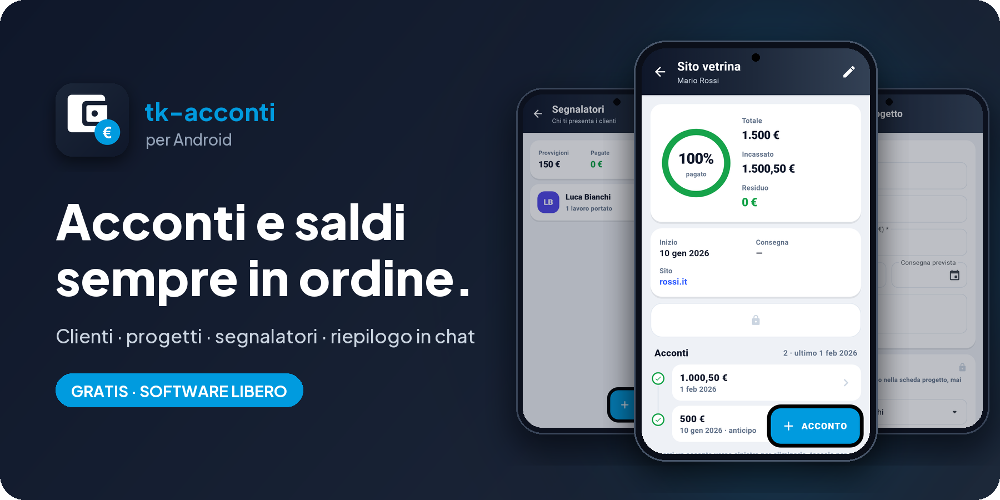
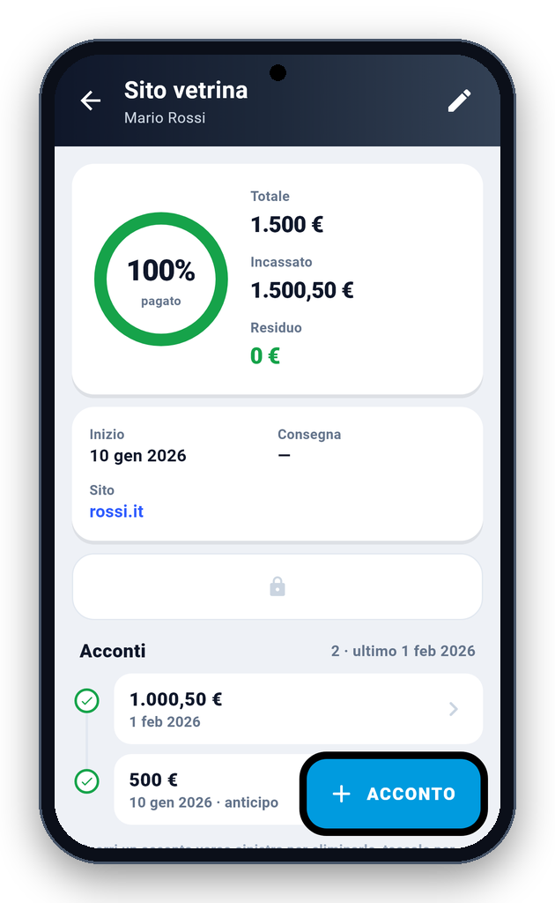
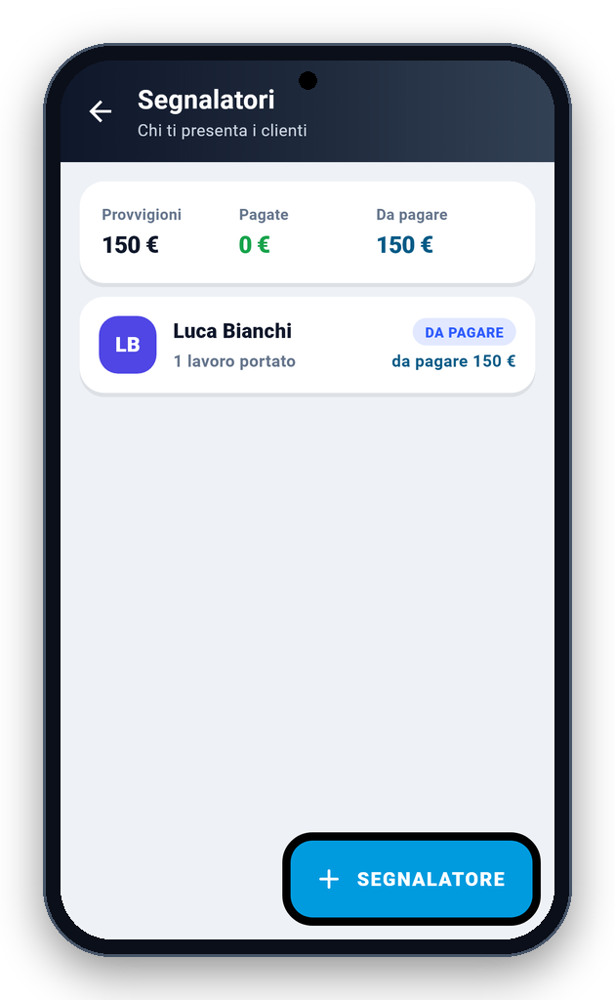
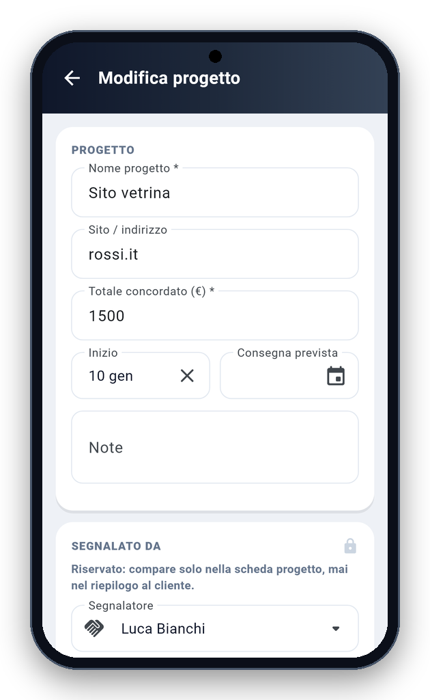
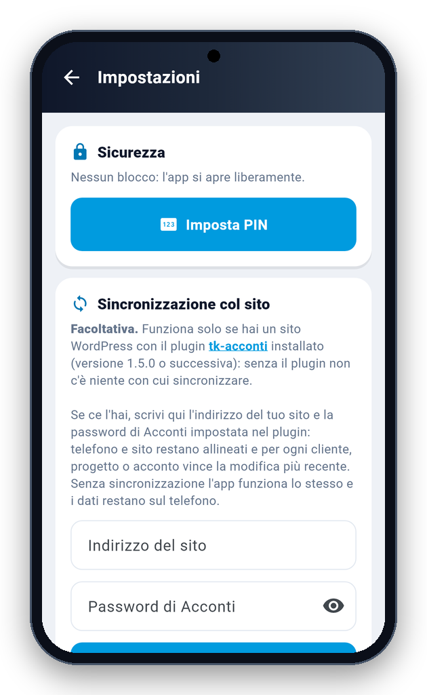

<!-- README generato da Dropbox/CLAUDE/dev/agpl-rollout/readme/genera_readme_app.py: modificare lì -->
<div align="center">



<br><br>

<a href="https://pietrodefilippis.it/scarica-app/tk-acconti/"></a> &nbsp; <a href="https://pietrodefilippis.it/donazione/"></a>

<br><br>

<a href="COPYING"></a>   

</div>

---

## ✨ Cosa fa

<table>
<tr>
<td width="50%" valign="top">

### 🗂️&nbsp; Clienti e progetti
Per ogni lavoro gli acconti versati e il saldo che resta.

</td>
<td width="50%" valign="top">

### 🤝&nbsp; Segnalatori
La loro parte, calcolata da sola.

</td>
</tr>
<tr>
<td width="50%" valign="top">

### 💬&nbsp; Riepilogo in chat
Il resoconto al cliente con un tocco.

</td>
<td width="50%" valign="top">

### 🔒&nbsp; PIN e impronta
L'app si apre solo con te.

</td>
</tr>
<tr>
<td width="50%" valign="top">

### 💾&nbsp; Copia di sicurezza
I tuoi dati sempre recuperabili.

</td>
<td width="50%" valign="top">

### 🔄&nbsp; Sincronizzazione col sito
Facoltativa, con la pagina Acconti del tuo sito.

</td>
</tr>
</table>

## 📱 Com'è fatta

<div align="center">

<table align="center">
<tr>
<td align="center" valign="top"><br><sub><b>Progetto</b></sub></td>
<td align="center" valign="top"><br><sub><b>Segnalatori</b></sub></td>
<td align="center" valign="top"><br><sub><b>Modifica progetto</b></sub></td>
</tr>
<tr>
<td align="center" valign="top"><br><sub><b>Impostazioni</b></sub></td>
</tr>
</table>

</div>

## 🔒 I tuoi dati

- **Privacy:** i dati restano sul telefono; con la sincronizzazione vanno solo al sito che scegli tu. Le statistiche anonime (una volta al giorno: nome, versione, sistema e un codice casuale) partono solo se dici sì nel benvenuto o in Informazioni.

Nessuna pubblicità, nessun account da creare, nessun abbonamento: tutte le funzioni sono gratis, per tutti.

## 📥 Installazione

- **Android** — [scarica l'app](https://pietrodefilippis.it/scarica-app/tk-acconti/) da pietrodefilippis.it e aprila: Android chiede una volta il permesso di installare app da questa origine. Gli aggiornamenti arrivano da soli, l'app te li propone. A breve anche su Google Play.
- **Piattaforme:** Android e iPhone.

<details>
<summary><b>🛠️ Compilare dal codice sorgente</b></summary>

<br>

Serve [Flutter](https://flutter.dev) (versione indicata in `.github/workflows/android.yml`):

```bash
flutter pub get
flutter test
flutter build apk --release
```

Senza la variabile `ANDROID_KEYSTORE` l'APK si firma con la chiave di debug di Flutter.

</details>

## 📜 Licenza

**tk-acconti** è software libero: © 2026 Pietro De Filippis (TecnikGeek), licenza
**[GNU Affero General Public License v3.0](COPYING)**. Puoi usarlo, studiarlo, modificarlo e condividerlo; è
fornito **così com'è, senza alcuna garanzia**.

> Il nome **tk-acconti** e il logo non sono coperti dalla licenza (AGPL, sezione 7): una versione modificata deve avere un nome diverso.

---

<div align="center">

**Ti è utile?** Tutte le funzioni sono gratis per tutti. Se vuoi, un caffè aiuta a migliorarla e a crearne altre.

<a href="https://pietrodefilippis.it/donazione/"></a>

<sub>Creata da <a href="https://pietrodefilippis.it">Pietro De Filippis · TecnikGeek</a> — Webmaster & UX/UI Designer</sub>

</div>
